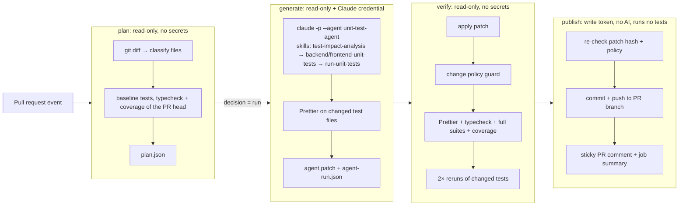

# Unit Test Agent: solution notes

A custom Claude Code agent (`unit-test-agent`) with four reusable skills. A
GitHub Actions workflow runs it on every pull request that changes frontend or
backend source. The agent decides whether the change needs new or updated unit
tests, writes them, and runs them. The workflow then **verifies the result
independently**, commits the verified tests to the PR branch, and reports
everything in a sticky PR comment. Sub-agents following the same agent
definition and skills also backfilled the tests that were missing from the
base repository.

**Status:** working end to end on GitHub, on
[PR #2](https://github.com/webguru11124/taskly-app-node/pull/2). See
[Example run](#example-run), and [Limitations](#limitations) for what hasn't been
exercised yet.



## Where things live

| Path | What |
| --- | --- |
| [`.claude/agents/unit-test-agent.md`](.claude/agents/unit-test-agent.md) | **Custom agent**: role, hard rules, five-step workflow, quality bar. Its `tools` allowlist is `Read, Grep, Glob, Edit, Write, Bash, Skill, StructuredOutput`. The Linux CI build doesn't offer `Grep` or `Glob`. |
| [`.claude/skills/test-impact-analysis/`](.claude/skills/test-impact-analysis/SKILL.md) | **Skill**: read the plan and decide `write` / `update` / `skip` per file, with a rubric for coverage gaps, baseline failures, type errors, deletions, and a budget. |
| [`.claude/skills/backend-unit-tests/`](.claude/skills/backend-unit-tests/SKILL.md) | **Skill**: backend conventions plus [patterns](.claude/skills/backend-unit-tests/reference/patterns.md) for routers, the app factory, Prisma, Zod, env config, and lifecycle code. |
| [`.claude/skills/frontend-unit-tests/`](.claude/skills/frontend-unit-tests/SKILL.md) | **Skill**: frontend conventions, an isolation strategy per unit type, and [patterns](.claude/skills/frontend-unit-tests/reference/patterns.md) for components, TanStack Query hooks, `fetch`, and time. |
| [`.claude/skills/run-unit-tests/`](.claude/skills/run-unit-tests/SKILL.md) | **Skill and the agent's only way to run code**: [`run-tests.mjs`](.claude/skills/run-unit-tests/scripts/run-tests.mjs) runs `test` / `typecheck` / `coverage` with validated arguments, a scrubbed environment, and a timeout, and ends with a machine-readable `RESULT` line. The skill also has a verification loop and a failure triage table. |
| [`.github/workflows/unit-test-agent.yml`](.github/workflows/unit-test-agent.yml) | **Agentic PR workflow**: the plan → generate → verify → publish jobs. |
| [`tools/test-agent/`](tools/test-agent) | Deterministic, zero-dependency orchestration: `plan.mjs`, `run-agent.mjs`, `format-changes.mjs`, `verify.mjs`, `guard.mjs`, `render-comment.mjs`, `check-outcome.mjs`, the CI permission policy [`claude-settings.json`](tools/test-agent/claude-settings.json), and the report [schema](tools/test-agent/agent-report.schema.json). 91 `node:test` tests in `test/`. |
| [`.github/workflows/ci.yml`](.github/workflows/ci.yml) | Regular CI: typecheck, tests with coverage, build, format check, and tooling tests. |

## How a run works

1. **plan** (`plan.mjs`): `git diff base...head` is classified with the same
   include/exclude rules as the coverage configs (types, barrels, stories,
   design system, and bootstrap are skipped, each with a reason). For each
   source file the plan collects changed line ranges, the tests that
   import or mock it, and a suggested test location. The job then runs each
   affected workspace's suite with coverage, plus `tsc`, on the PR head. A
   file becomes a **target** only if some of its changed executable lines
   are uncovered, or if its workspace has failing tests or type errors.
   Otherwise nothing runs and nothing is spent.
2. **generate** (`run-agent.mjs`): runs
   `claude -p --agent unit-test-agent --permission-mode dontAsk --permission-prompts none --setting-sources project --settings tools/test-agent/claude-settings.json --strict-mcp-config --json-schema <report schema>`.
   The prompt holds only the plan summary (validated file paths and line
   ranges), never PR titles, bodies, or comments. Claude Code runs the agent's
   shell commands in a `bubblewrap` sandbox with credentials scrubbed. The agent:
   - loads **`test-impact-analysis`** and records a decision per target,
   - loads **`backend-unit-tests`** and/or **`frontend-unit-tests`** for the
     workspaces it touches,
   - writes tests, then loads **`run-unit-tests`** and loops through
     typecheck, the touched files, the whole suite, coverage, and 3× reruns,
   - returns a schema-validated report (decisions, test files, verification,
     findings).

   The runner streams compact progress into the job log and derives
   *skills used*, tool counts, files written, and every test run's `RESULT`
   from the event stream. It doesn't rely on the agent's self-report. The
   workflow then applies Prettier to the changed frontend test files, because
   the agent has no formatter, and collects the changes as a patch.
3. **verify** (`verify.mjs`): applies the patch to a clean checkout and
   enforces the [change policy](tools/test-agent/lib/policy.mjs): only test
   files, no deletions, symlinks, or binaries; no `.only`/`.skip`,
   `@ts-ignore`, process spawning, raw sockets, external hosts, or reading
   credentials; size limits; and assertions required in new files. Only then
   does it run Prettier's check, `tsc`, both full suites with coverage, and two
   reruns of the changed test files. It records coverage of the changed lines
   before and after.
4. **publish**: checks that the patch hash matches the verified one, re-runs
   the policy guard, commits as `github-actions[bot]`, and fast-forward
   pushes to the PR branch, which fails safely if the branch moved. It then
   dispatches CI for the new commit and creates or updates one sticky comment.
   The run ends red if the agent failed or its tests weren't accepted.

## Main technical decisions

| Decision | Why |
| --- | --- |
| **Claude Code CLI in headless mode as the agent runtime** (`--agent`, project skills), pinned to `2.1.311` | Agents and skills are plain Markdown in the repo. The same definitions work interactively for developers (`claude --agent unit-test-agent`) and in CI. Built-in permission rules, the `bubblewrap` sandbox, and `--json-schema` structured output cover most of the guardrails without custom agent code. I chose the CLI over `claude-code-action` so the agent job needs **no GitHub token at all** and runs the same way locally. |
| **Deterministic plan before the agent** | Cheap, reproducible decisions (what changed, what is uncovered, which tests relate) come from code, not tokens. The agent gets a precise brief, and PRs that need nothing don't start a model at all. |
| **Agent proposes, pipeline disposes** | The agent never pushes. Its patch goes through a separate verify job without secrets, and the comment's verification results come from that job. Agent-written text is shown as the agent's and sanitised. |
| **Three layers of write restriction** | Claude Code permission rules (allow only test paths, plus deny rules), the agent's hard rules, and the authoritative post-run policy guard, which is unit tested. |
| **One wrapper script as the only way to run code** (Claude Code still allows its built-in read-only commands) | Argument allow-listing, an env allow-list (test code never sees the OAuth token or `GITHUB_TOKEN`), timeouts, trimmed output, and a parseable `RESULT` line for the agent, the runner, and humans. |
| **Verification mirrors CI** | "Verified" should predict CI. Run 41778398801 showed the gap when a verified commit failed the format check. Test-only changes now go through the same format, type, and test checks. CI also runs a build and `prisma validate`, which test files don't affect. One difference remains: CI fails on missed coverage thresholds, while verification only reports them. |
| **Coverage of changed lines as the trigger, behaviour as the goal** | Coverage decides *whether* to call the agent. The skills tell it to assert behaviour and to report suspected bugs rather than encode them. |
| **Skills split by concern** (analysis, backend conventions, frontend conventions, running) | Each skill is reusable alone (for example `/frontend-unit-tests` in a local session). The agent loads only what the change needs (progressive disclosure keeps context small), and convention updates don't touch the agent. |
| **Zero-dependency Node `.mjs` tooling** | Nothing to install or audit at the repo root. It runs on any Node ≥ 22 and is tested with `node:test`. |

## Running it

**Prerequisites**

1. GitHub Actions enabled for the repository (the default).
2. A repository secret **`CLAUDE_CODE_OAUTH_TOKEN`** (create one with
   `claude setup-token`, which needs a Claude Pro or Max plan), *or*
   `ANTHROPIC_API_KEY`. Without either, the workflow still runs the analysis
   and the PR comment explains what is missing. Make sure the copied token has no
   line breaks: a bad token shows up as a 401 in the PR comment.
3. Optional repository variables: `TEST_AGENT_MODEL` (default `sonnet`) and
   `TEST_AGENT_MAX_TURNS` (default `80`).
4. Optional labels: `test-agent:skip` (opt a PR out) and `test-agent:run`
   (force a run even when changed lines are already covered).

**Triggering:** open or update a non-draft PR from a branch in this repository
that touches `backend/src`, `backend/tests`, or `frontend/src`. Results appear
as a sticky PR comment, job summaries, and artifacts (`plan.json`,
`agent-run.json`, the raw agent event log, the patch, and `verification.json`).

**Locally**

```bash
cd backend && npm ci && cd ../frontend && npm ci && cd ..
node tools/test-agent/plan.mjs --base origin/main --head HEAD --with-coverage   # writes .test-agent/plan.json
node tools/test-agent/run-agent.mjs --plan .test-agent/plan.json                 # needs `claude` logged in, and bubblewrap on Linux
node .claude/skills/run-unit-tests/scripts/run-tests.mjs frontend coverage       # any skill script on its own
claude --agent unit-test-agent "Add tests for frontend/src/lib/http.ts"          # interactive use
```

I have only run the agent end to end in CI, not with these local commands.

`plan.mjs --mode backfill --workspaces backend,frontend` lists every source
file below a coverage threshold. I added it after starting the initial
backfill, which was scoped from the baseline Vitest coverage reports.

## Coverage backfill (base repository)

Two general-purpose Claude Code sub-agents did the backfill in parallel, one
per workspace. I told each to read and follow the `unit-test-agent` definition
and the skill files. This was not a `claude --agent` run, and the CI permission
policy was not in force: "only test files" and "only `run-tests.mjs`" were
instructions. The backend sub-agent reported one departure, which was read-only:
it used `head`, `cat`, and a pipe to `tail`. I then applied Prettier to the
result, which changed one file.

I ran `verify.mjs` on the committed tests (commit `49f7c8e`) afterwards. Each
workspace was checked separately on a clean checkout of the previous commit,
because they were separate runs and the combined 26-file patch exceeds the
policy's 25-file limit. Coverage in the table comes from local Vitest runs of
the backfill.

| Verification | Files | Policy violations | Typecheck | Tests | 2× reruns | Targets at 100 % lines and branches |
| --- | --- | --- | --- | --- | --- | --- |
| backend | 7 | 0 | passed | 118/118 | stable | 7 of 7 |
| frontend | 19 | 0 | passed | 117/117 | stable | 18 of 18 |

| Workspace | Tests (files) | Statements | Branches | Functions | Lines |
| --- | --- | --- | --- | --- | --- |
| backend, before | 48 (4) | 30.2 % | 33.3 % | 40.6 % | 33.0 % |
| **backend, after** | **118 (10)** | **100 %** | **100 %** | **100 %** | **100 %** |
| frontend, before | 18 (14) | 46.4 % | 43.8 % | 40.3 % | 47.7 % |
| **frontend, after** | **117 (23)** | **100 %** | **100 %** | **100 %** | **100 %** |

New coverage areas:
- Backend: the app factory's error mapping (422, 413, 500, and 404), the
  health probe, env-based DB URL resolution, schema bootstrap, the startup and
  graceful-shutdown lifecycle, and every router route, including id
  validation.
- Frontend: the `fetch` wrapper's error mapping, all TanStack Query hooks
  (including cache updates and stale-fetch cancellation), every component
  state, and the page's orchestration.

The Vitest configs now enforce thresholds (backend: 90 % per file; frontend:
95 % / 90 % branches overall), so these gains can't silently regress.

The agents also reported **findings without encoding them in tests**. They
are left for the maintainers:

- `backend/src/factory.ts`: body-parser client errors other than
  parse/too-large (for example 415 for an unsupported charset) become a
  logged 500.
- `backend/src/core/lifespan.ts`: if `$disconnect()` fails during a failed
  startup, its error replaces the original one.
- `frontend/src/lib/http.ts`: headers are merged with an object spread, so a
  `Headers` instance passed by a caller would be dropped.

## Example run

[PR #2](https://github.com/webguru11124/taskly-app-node/pull/2) adds "duplicate a
task" to both workspaces, with no test changes. These are the results of
[run 41779206705](https://github.com/webguru11124/taskly-app-node/actions/runs/41779206705)
on head `b967a25`, which took 4m 6s in total.

**Analysis.** The plan decided `run` with 7 targets and left out
`backend/openapi.json`, `types.ts` and `queryKeys.ts`, each with a reason. Its
baseline recorded what the feature broke: 1 backend type error (a stale
`TodoStore` stub), 8 frontend type errors (missing `onDuplicate` props), and 10
failing `TodosPage` tests (an unmocked hook).

**Agent decisions**, from its structured report:

| Source file | Decision | Reason, shortened | Changed lines covered |
| --- | --- | --- | --- |
| `backend/.../repository.ts` | update | `duplicate()` was uncovered: copy fields, 120-character truncation, missing source | 2/7 → 7/7 |
| `backend/.../router.ts` | update | New route uncovered: 201, 404, invalid id. Store stub fixed | 1/4 → 4/4 |
| `frontend/.../useDuplicateTodoMutation.ts` | write | New hook without tests: cache update, deduplication, empty cache, error | 2/6 → 6/6 |
| `frontend/.../api/todos.ts` | update | New API call uncovered | 0/1 → 1/1 |
| `frontend/.../TodoList.tsx` | update | `onDuplicate` forwarding uncovered. Stubs fixed | 0/1 → 1/1 |
| `frontend/.../TodoItem.tsx` | update | New button: click and busy-disabled tests. Props fixed | 0/0 → 0/0 |
| `frontend/.../TodosPage.tsx` | update | Mocked the hook that broke 10 tests. Success, failure, busy and retry tests | 2/8 → 8/8 |

**Skills used**, from the event stream, in order: `test-impact-analysis` →
`backend-unit-tests` → `frontend-unit-tests` → `run-unit-tests`. The session took
61 turns and 1m 41s on `claude-sonnet-5-5`, with Claude Code 2.1.311. Nothing was
blocked, and the agent reported no findings.

**The agent's own test runs:** typecheck (both passed), whole suites (backend
124/124, frontend 126/126), coverage, and `--runs 3` on the files it touched
(backend 50/50, frontend 38/38, stable). Its first two coverage commands failed
because it passed several files to one `--source`, and it corrected them. The
skill now spells out that syntax, after this run.

**Independent verification**, in a job without secrets:

| Check | Backend | Frontend |
| --- | --- | --- |
| Change policy | 7 files, +206 lines, test files only, no violations or warnings | same patch |
| Prettier | not used in this workspace | passed (the workflow formatted 5 files first) |
| Typecheck | passed | passed |
| Full suite | 124/124 | 126/126 |
| New tests | +6 | +9 |
| 2× reruns of changed files | stable | stable |
| Coverage thresholds | met | met |

**Result.** The workflow committed the tests as
[`fa174b3`](https://github.com/webguru11124/taskly-app-node/commit/fa174b3) and
updated the [PR comment](https://github.com/webguru11124/taskly-app-node/pull/2).
The CI run it dispatched for that commit
([41779599055](https://github.com/webguru11124/taskly-app-node/actions/runs/41779599055))
passed. I also re-ran the PR's CI run by hand, so its checks show on the PR (see
[Limitations](#limitations)).

### What the earlier runs found

PR #2's history contains several agent commits and reverts on purpose. Each run
exposed something that unit tests with stubbed runs could not, so I fixed it,
reverted the agent's tests, and ran it again from the same starting point.

| Run | What happened | Fix |
| --- | --- | --- |
| [41774755274](https://github.com/webguru11124/taskly-app-node/actions/runs/41774755274) | The agent crashed at startup, because subprocess scrubbing needs `bubblewrap`. The workflow still ended green, and the comment gave no reason | Install `bubblewrap` rather than disable scrubbing. Fail the run when the agent fails. Show the error |
| [41775231383](https://github.com/webguru11124/taskly-app-node/actions/runs/41775231383) | 401 from the API: the saved token was rejected. The session also reported permission mode `default` | Replaced the token. Added `--permission-prompts none` and a check on the reported mode |
| [41776082938](https://github.com/webguru11124/taskly-app-node/actions/runs/41776082938) (attempt 2) | First complete run. The sandbox's empty placeholder for a missing root `package.json` broke Vite, so the agent couldn't run frontend tests. Verify still showed they passed. No structured report came back, because the agent's `tools` allowlist also filtered the tool behind `--json-schema` | Added a root `package.json`. Allowed `StructuredOutput`. The comment now shows the agent's notes |
| [41777621018](https://github.com/webguru11124/taskly-app-node/actions/runs/41777621018) | The agent skipped `run-unit-tests`, coverage, and reruns, because other skills quoted the runner command. The policy denied a Python edit script and a `for` loop | Those skills now point to `run-unit-tests`. The agent definition and prompt list the required checks |
| [41778398801](https://github.com/webguru11124/taskly-app-node/actions/runs/41778398801) | All steps ran and verification passed, but the commit failed CI's format check, which verification didn't cover | Format the agent's files in the workflow, and add a Prettier check to verification |

The denials in run 41777621018 show the policy working on GitHub. Claude Code
answered: "Permission for this tool use was denied. It requires approval, and this
session has no approval surface". Inside the sandbox, files such as `.env` and
`.mcp.json` were masked with `/dev/null`.

[PR #1](https://github.com/webguru11124/taskly-app-node/pull/1) came earlier. It
ran before a credential existed, so it only shows the missing-credential and skip
paths. I wrote its tests by hand to get its CI passing.

## Assumptions

- Contributors who can push branches to this repository are trusted. That is
  GitHub's own model for `pull_request` workflows with secrets, so fork PRs
  are skipped.
- "Unit tests" means fast, isolated tests that need no database, network, or
  `.env`. Integration tests against PostgreSQL are out of scope.
- Committing verified tests directly to the PR branch is acceptable, since the
  PR author reviews them as part of their own PR. The opt-out label covers
  everyone else.
- The design system is documented through Storybook and is excluded from
  coverage by the existing config, so the agent leaves it alone too.

## Limitations

- **Not exercised on GitHub:** an agent edit outside the allowed test paths (no
  run attempted one), a patch rejected by the policy or failing verification, a
  branch moving during a run, and the `test-agent:run` label. Unit tests with
  stubbed runs cover the policy and verification outcomes, and `verify.mjs`
  rejected a real oversized patch locally.
- **The agent's checks are instructions, not enforcement.** Run 41777621018 shows
  it can skip them. Verification is the real gate, but it only reports coverage,
  so tests that pass and leave changed lines uncovered would still be committed.
- **The reported permission mode is `default`, not `dontAsk`.** Claude Code
  changes it when subprocess scrubbing is on. `--permission-prompts none` keeps
  deny-by-default, and the runner refuses any other mode.
- **Line coverage is the trigger.** A covered line whose behaviour changed
  (for example a constant) won't trigger a run unless tests fail or someone
  adds `test-agent:run`.
- **The agent's commit needs a manual step to show PR checks.** Commits pushed with
  `GITHUB_TOKEN` start `pull_request` runs that stop at `action_required`. The CI
  run the workflow dispatches does run, but its results aren't listed on the PR.
  On PR #2 I re-ran the CI run by hand. The Unit Test Agent run stays at
  `action_required`, and the PR's merge state shows `UNSTABLE`.
- **Each run replaces the sticky comment.** A later push or re-run with nothing
  left to test replaces the details with "No test changes needed". They remain in
  that run's job summary and artifacts.
- **No fork PR support** (no secrets on fork PRs, by design).
- **Model output varies.** The same PR got 16, 14, 14, and 15 new tests across the
  four complete runs. Agent "findings" are not verified.
- **Cost and latency.** The final run's agent session took under 2 minutes, and the
  CLI estimated about $0.43. It is bounded by `--max-turns`, a 25-minute agent
  timeout, and a 40-minute job timeout, but there is no token budget for OAuth
  subscriptions.
- **Mutation testing isn't run**, so test strength beyond coverage, typecheck,
  and stability relies on the skills' quality bar.

## What I would change for production

- **Run through a GitHub App** instead of `GITHUB_TOKEN`: required checks
  re-run on the bot's commit, it has a scoped identity, and branch protection
  can tell its commits apart.
- **Keep the secret in a GitHub Environment** (`unit-test-agent`) with
  required reviewers for first-time contributors, and add **egress filtering**
  (for example `step-security/harden-runner` in block mode) to the generate
  and verify jobs.
- **Support fork PRs** with a two-workflow design: an unprivileged
  `pull_request` run produces the plan, and a `workflow_run` with secrets runs
  the agent on the trusted base revision of the tooling.
- **Mutation testing** (Stryker) on the targeted files as an extra
  verification signal, and a "test strength" score in the comment.
- **Suggestions mode**: post the tests as a review with suggested changes
  instead of pushing, configurable per repository.
- **Scheduled backfill workflow** (`plan.mjs --mode backfill`) that opens one
  PR per week for the least-covered files. Ratchet the coverage thresholds in
  the Vitest configs after each one.
- **Telemetry**: track per run cost, turns, acceptance rate of agent commits,
  and how often verification rejects output, to tune prompts, skills, and
  model choice.
