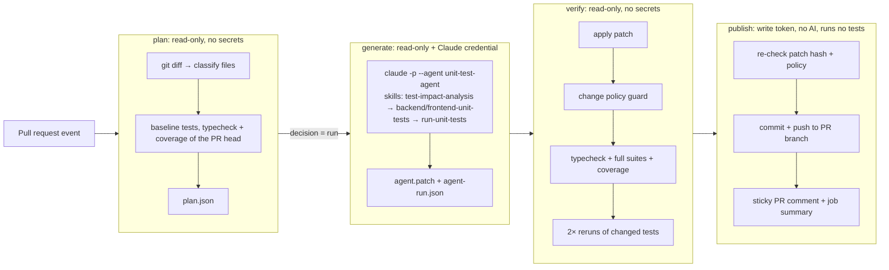

# Unit Test Agent: solution notes

A custom Claude Code agent (`unit-test-agent`) with four reusable skills. A
GitHub Actions workflow runs it on every pull request that changes frontend or
backend source. The agent decides whether the change needs new or updated unit
tests, writes them, and runs them. The workflow then **verifies the result
independently**, commits the verified tests to the PR branch, and reports
everything in a sticky PR comment. Sub-agents following the same agent
definition and skills also backfilled the tests that were missing from the
base repository.

**Status:** the workflow's analysis, reporting and skip paths have run on
GitHub. The agent itself has not run through this workflow yet, because the
repository has no Claude credential configured. See [Example run](#example-run).



## Where things live

| Path | What |
| --- | --- |
| [`.claude/agents/unit-test-agent.md`](.claude/agents/unit-test-agent.md) | **Custom agent**: role, hard rules, five-step workflow, quality bar. Tools are limited to `Read, Grep, Glob, Edit, Write, Bash, Skill`. |
| [`.claude/skills/test-impact-analysis/`](.claude/skills/test-impact-analysis/SKILL.md) | **Skill**: read the plan and decide `write` / `update` / `skip` per file, with a rubric for coverage gaps, baseline failures, type errors, deletions, and a budget. |
| [`.claude/skills/backend-unit-tests/`](.claude/skills/backend-unit-tests/SKILL.md) | **Skill**: backend conventions plus [patterns](.claude/skills/backend-unit-tests/reference/patterns.md) for routers, the app factory, Prisma, Zod, env config, and lifecycle code. |
| [`.claude/skills/frontend-unit-tests/`](.claude/skills/frontend-unit-tests/SKILL.md) | **Skill**: frontend conventions, an isolation strategy per unit type, and [patterns](.claude/skills/frontend-unit-tests/reference/patterns.md) for components, TanStack Query hooks, `fetch`, and time. |
| [`.claude/skills/run-unit-tests/`](.claude/skills/run-unit-tests/SKILL.md) | **Skill and the agent's only way to run code**: [`run-tests.mjs`](.claude/skills/run-unit-tests/scripts/run-tests.mjs) runs `test` / `typecheck` / `coverage` with validated arguments, a scrubbed environment, and a timeout, and ends with a machine-readable `RESULT` line. The skill also has a verification loop and a failure triage table. |
| [`.github/workflows/unit-test-agent.yml`](.github/workflows/unit-test-agent.yml) | **Agentic PR workflow**: the plan → generate → verify → publish jobs. |
| [`tools/test-agent/`](tools/test-agent) | Deterministic, zero-dependency orchestration: `plan.mjs`, `run-agent.mjs`, `verify.mjs`, `guard.mjs`, `render-comment.mjs`, the CI permission policy [`claude-settings.json`](tools/test-agent/claude-settings.json), and the report [schema](tools/test-agent/agent-report.schema.json). 77 `node:test` tests in `test/`. |
| [`.github/workflows/ci.yml`](.github/workflows/ci.yml) | Regular CI: typecheck, tests with coverage, build, format check, and tooling tests. |

## How a run works

1. **plan** (`plan.mjs`): `git diff base...head` is classified with the same
   include/exclude rules as the coverage configs (types, barrels, stories,
   design system, and bootstrap are skipped, each with a reason). For each
   source file the plan collects changed line ranges, the tests that
   import or mock it, and a suggested test location. The job then runs each
   affected workspace's suite with coverage, plus `tsc`, on the PR head. A
   file becomes a **target** only if some of its changed executable lines
   are uncovered, or if its workspace has failing tests or type errors.
   Otherwise nothing runs and nothing is spent.
2. **generate** (`run-agent.mjs`): runs
   `claude -p --agent unit-test-agent --permission-mode dontAsk --permission-prompts none --setting-sources project --settings tools/test-agent/claude-settings.json --strict-mcp-config --json-schema <report schema>`.
   The prompt holds only the plan summary (validated file paths and line
   ranges), never PR titles, bodies, or comments. The agent:
   - loads **`test-impact-analysis`** and records a decision per target,
   - loads **`backend-unit-tests`** and/or **`frontend-unit-tests`** for the
     workspaces it touches,
   - writes tests, then loads **`run-unit-tests`** and loops through
     typecheck, the touched files, the whole suite, coverage, and 3× reruns,
   - returns a schema-validated report (decisions, test files, verification,
     findings).

   The runner streams compact progress into the job log and derives
   *skills used*, tool counts, files written, and every test run's `RESULT`
   from the event stream. It doesn't rely on the agent's self-report.
3. **verify** (`verify.mjs`): applies the patch to a clean checkout and
   enforces the [change policy](tools/test-agent/lib/policy.mjs): only test
   files, no deletions, symlinks, or binaries; no `.only`/`.skip`,
   `@ts-ignore`, process spawning, raw sockets, external hosts, or reading
   credentials; size limits; and assertions required in new files. Only then
   does it run `tsc`, both full suites with coverage, and two reruns of the
   changed test files. It records coverage of the changed lines before and
   after.
4. **publish**: checks that the patch hash matches the verified one, re-runs
   the policy guard, commits as `github-actions[bot]`, and fast-forward
   pushes to the PR branch, which fails safely if the branch moved. It then
   dispatches CI for the new commit and creates or updates one sticky comment.

## Main technical decisions

| Decision | Why |
| --- | --- |
| **Claude Code CLI in headless mode as the agent runtime** (`--agent`, project skills), pinned to `2.1.311` | Agents and skills are plain Markdown in the repo. The same definitions work interactively for developers (`claude --agent unit-test-agent`) and in CI. Built-in permission rules, `dontAsk` mode, and `--json-schema` structured output cover most of the guardrails without custom agent code. I chose the CLI over `claude-code-action` so the agent job needs **no GitHub token at all** and runs the same way locally. |
| **Deterministic plan before the agent** | Cheap, reproducible decisions (what changed, what is uncovered, which tests relate) come from code, not tokens. The agent gets a precise brief, and PRs that need nothing don't start a model at all. |
| **Agent proposes, pipeline disposes** | The agent never pushes. Its patch goes through a separate verify job without secrets, and every number in the PR comment comes from that job. Agent-written text is shown as the agent's opinion and sanitised. |
| **Three layers of write restriction** | Claude Code permission rules (allow only test paths, plus deny rules), the agent's hard rules, and the authoritative post-run policy guard, which is unit tested. |
| **One wrapper script as the only way to run code** (Claude Code still allows its built-in read-only commands) | Argument allow-listing, an env allow-list (test code never sees the OAuth token or `GITHUB_TOKEN`), timeouts, trimmed output, and a parseable `RESULT` line for the agent, the runner, and humans. |
| **Coverage of changed lines as the trigger, behaviour as the goal** | Coverage decides *whether* to call the agent. The skills tell it to assert behaviour and to report suspected bugs rather than encode them. |
| **Skills split by concern** (analysis, backend conventions, frontend conventions, running) | Each skill is reusable alone (for example `/frontend-unit-tests` in a local session). The agent loads only what the change needs (progressive disclosure keeps context small), and convention updates don't touch the agent. |
| **Zero-dependency Node `.mjs` tooling** | Nothing to install or audit at the repo root. It runs on any Node ≥ 22 and is tested with `node:test`. |

## Running it

**Prerequisites**

1. GitHub Actions enabled for the repository (the default).
2. A repository secret **`CLAUDE_CODE_OAUTH_TOKEN`** (create one with
   `claude setup-token`, which needs a Claude Pro or Max plan), *or*
   `ANTHROPIC_API_KEY`. Without either, the workflow still runs the analysis
   and the PR comment explains what is missing.
3. Optional repository variables: `TEST_AGENT_MODEL` (default `sonnet`) and
   `TEST_AGENT_MAX_TURNS` (default `80`).
4. Optional labels: `test-agent:skip` (opt a PR out) and `test-agent:run`
   (force a run even when changed lines are already covered).

**Triggering:** open or update a non-draft PR from a branch in this repository
that touches `backend/src`, `backend/tests`, or `frontend/src`. Results appear
as a sticky PR comment, job summaries, and artifacts (`plan.json`,
`agent-run.json`, the raw agent event log, the patch, and `verification.json`).

**Locally**

```bash
cd backend && npm ci && cd ../frontend && npm ci && cd ..
node tools/test-agent/plan.mjs --base origin/main --head HEAD --with-coverage   # writes .test-agent/plan.json
node tools/test-agent/run-agent.mjs --plan .test-agent/plan.json                 # needs `claude` logged in
node .claude/skills/run-unit-tests/scripts/run-tests.mjs frontend coverage       # any skill script on its own
claude --agent unit-test-agent "Add tests for frontend/src/lib/http.ts"          # interactive use
```

`plan.mjs --mode backfill --workspaces backend,frontend` lists every source
file below a coverage threshold. I added it after starting the initial
backfill, which was scoped from the baseline Vitest coverage reports.

## Coverage backfill (base repository)

Two general-purpose Claude Code sub-agents did the backfill in parallel, one
per workspace. I told each to read and follow the `unit-test-agent` definition
and the skill files. This was not a `claude --agent` run, and the CI permission
policy was not in force: "only test files" and "only `run-tests.mjs`" were
instructions. The backend sub-agent reported one departure, which was read-only:
it used `head`, `cat`, and a pipe to `tail`. I then applied Prettier to the
result, which changed one file.

I ran `verify.mjs` on the committed tests (commit `49f7c8e`) afterwards. Each
workspace was checked separately on a clean checkout of the previous commit,
because they were separate runs and the combined 26-file patch exceeds the
policy's 25-file limit. Coverage in the table comes from local Vitest runs of
the backfill.

| Verification | Files | Policy violations | Typecheck | Tests | 2× reruns | Targets at 100 % lines and branches |
| --- | --- | --- | --- | --- | --- | --- |
| backend | 7 | 0 | passed | 118/118 | stable | 7 of 7 |
| frontend | 19 | 0 | passed | 117/117 | stable | 18 of 18 |

| Workspace | Tests (files) | Statements | Branches | Functions | Lines |
| --- | --- | --- | --- | --- | --- |
| backend, before | 48 (4) | 30.2 % | 33.3 % | 40.6 % | 33.0 % |
| **backend, after** | **118 (10)** | **100 %** | **100 %** | **100 %** | **100 %** |
| frontend, before | 18 (14) | 46.4 % | 43.8 % | 40.3 % | 47.7 % |
| **frontend, after** | **117 (23)** | **100 %** | **100 %** | **100 %** | **100 %** |

New coverage areas:
- Backend: the app factory's error mapping (422, 413, 500, and 404), the
  health probe, env-based DB URL resolution, schema bootstrap, the startup and
  graceful-shutdown lifecycle, and every router route, including id
  validation.
- Frontend: the `fetch` wrapper's error mapping, all TanStack Query hooks
  (including cache updates and stale-fetch cancellation), every component
  state, and the page's orchestration.

The Vitest configs now enforce thresholds (backend: 90 % per file; frontend:
95 % / 90 % branches overall), so these gains can't silently regress.

The agents also reported **findings without encoding them in tests**. They
are left for the maintainers:

- `backend/src/factory.ts`: body-parser client errors other than
  parse/too-large (for example 415 for an unsupported charset) become a
  logged 500.
- `backend/src/core/lifespan.ts`: if `$disconnect()` fails during a failed
  startup, its error replaces the original one.
- `frontend/src/lib/http.ts`: headers are merged with an object spread, so a
  `Headers` instance passed by a caller would be dropped.

## Example run

**The agent has not run end to end yet**, because no Claude credential is
configured on the repository. So this section can't yet show agent decisions,
skills used, or tests the agent generated. Both runs below come from
[PR #1](https://github.com/webguru11124/taskly-app-node/pull/1), and in both the
`Generate tests (agent)` and `Verify generated tests` jobs were skipped.

**[Run 41595323223](https://github.com/webguru11124/taskly-app-node/actions/runs/41595323223)
(head `cedb37e`, the feature without tests).** The plan decided `run` and found
6 targets. The publish job posted a comment saying the credential was missing.

| Target | Change | Changed lines | Uncovered before |
| --- | --- | --- | --- |
| `frontend/src/features/todos/hooks/useClearCompletedMutation.ts` | added | 1-19 | 10, 13-15 |
| `backend/src/features/todos/repository.ts` | modified | 51-55 | 53-54 |
| `backend/src/features/todos/router.ts` | modified | 19-22 | 21 |
| `frontend/src/features/todos/components/ClearCompletedButton.tsx` | added | 1-43 | 19-22, 28, 33 |
| `frontend/src/features/todos/api/todos.ts` | modified | 34-35 | 34 |
| `frontend/src/features/todos/TodosPage.tsx` | modified | 5, 27, 65-75 | 69 |

The plan left out `backend/openapi.json`, `types.ts` and `queryKeys.ts`, each
with a reason. Its baseline recorded the breakage the feature caused: 1 backend
type error (the stale `TodoStore` stub) and 10 failing frontend tests.

**[Run 41604349785](https://github.com/webguru11124/taskly-app-node/actions/runs/41604349785)
(head `4eb3ee5`, after tests were added).** These tests were written by hand,
not by the agent, to get the PR's CI passing. The plan decided `skip`, because
all 6 changed files were covered by passing tests (backend 121, frontend 131).
The sticky comment was updated to "No test changes needed".

## Assumptions

- Contributors who can push branches to this repository are trusted. That is
  GitHub's own model for `pull_request` workflows with secrets, so fork PRs
  are skipped.
- "Unit tests" means fast, isolated tests that need no database, network, or
  `.env`. Integration tests against PostgreSQL are out of scope.
- Committing verified tests directly to the PR branch is acceptable, since the
  PR author reviews them as part of their own PR. The opt-out label covers
  everyone else.
- The design system is documented through Storybook and is excluded from
  coverage by the existing config, so the agent leaves it alone too.

## Limitations

- **The reported permission mode is `default`, not `dontAsk`.** Claude Code
  changes it when subprocess scrubbing is on. `--permission-prompts none` keeps
  deny-by-default, and the runner refuses any other mode.
- **Not yet exercised on GitHub:** the Claude CLI step, skill loading through
  the `Skill` tool, the structured report, `verify` on an agent patch in CI,
  and the commit and push. Their logic has unit tests with stubbed runs, and
  `verify.mjs` has run locally on real patches, but the first real run may need
  fixes.
- **Line coverage is the trigger.** A covered line whose behaviour changed
  (for example a constant) won't trigger a run unless tests fail or someone
  adds `test-agent:run`.
- **Commits pushed with `GITHUB_TOKEN` don't trigger workflows.** The publish
  job dispatches `ci.yml` instead. I haven't confirmed yet how those results
  appear on the PR, and `pull_request`-scoped required checks would need a
  GitHub App token.
- **No fork PR support** (no secrets on fork PRs, by design).
- **Model output varies.** Verification makes bad output harmless (it is
  discarded and reported), but not impossible. Agent "findings" are not
  verified.
- **Cost and latency.** One agent run costs a few minutes and a slice of
  subscription quota. It is bounded by `--max-turns`, a 25-minute agent
  timeout, and a 40-minute job timeout, but there is no token budget for
  OAuth subscriptions.
- **Mutation testing isn't run**, so test strength beyond coverage, typecheck,
  and stability relies on the skills' quality bar.

## What I would change for production

- **Run through a GitHub App** instead of `GITHUB_TOKEN`: required checks
  re-run on the bot's commit, it has a scoped identity, and branch protection
  can tell its commits apart.
- **Keep the secret in a GitHub Environment** (`unit-test-agent`) with
  required reviewers for first-time contributors, and add **egress filtering**
  (for example `step-security/harden-runner` in block mode) to the generate
  and verify jobs.
- **Support fork PRs** with a two-workflow design: an unprivileged
  `pull_request` run produces the plan, and a `workflow_run` with secrets runs
  the agent on the trusted base revision of the tooling.
- **Mutation testing** (Stryker) on the targeted files as an extra
  verification signal, and a "test strength" score in the comment.
- **Suggestions mode**: post the tests as a review with suggested changes
  instead of pushing, configurable per repository.
- **Scheduled backfill workflow** (`plan.mjs --mode backfill`) that opens one
  PR per week for the least-covered files. Ratchet the coverage thresholds in
  the Vitest configs after each one.
- **Telemetry**: track per run cost, turns, acceptance rate of agent commits,
  and how often verification rejects output, to tune prompts, skills, and
  model choice.
